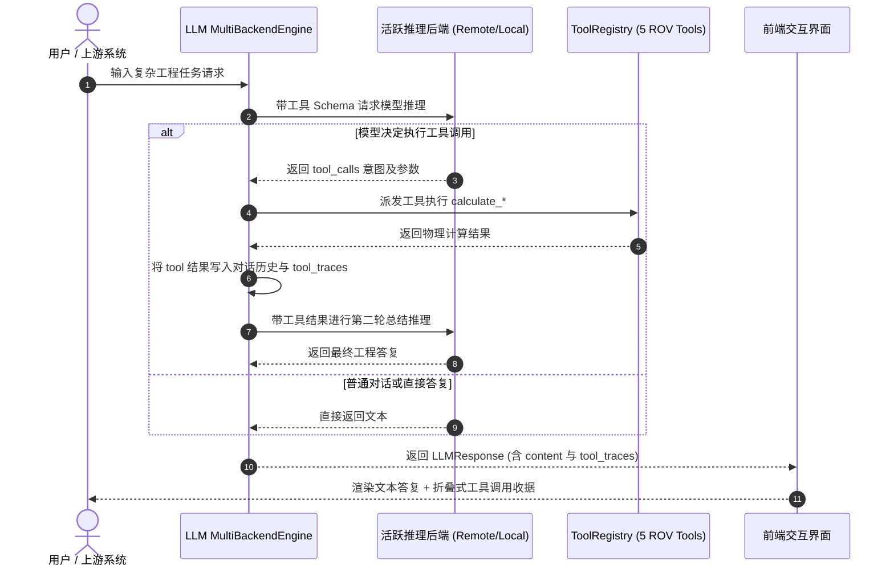

# SEAgent 多推理后端、Tool Calling 闭环与治理矩阵全量验收进展报告

## 元数据与环境规范

| 属性 | 详情 |
| :--- | :--- |
| 项目名称 | SEAgent (Pitohuie-AIversion/seagent1.0-main_asr) |
| 当前分支 | `main` |
| 基准 Commit | `2708e57` |
| 运行环境 | Linux, Python 3.12.3, Node.js v18.20.8, pytest-9.1.1 |
| 审查日期 | 2026-11-10 |
| 综合评审结论 | **PASS** |

---

## 1. 执行摘要与阶段成果 (Executive Summary)

本阶段工作依据 `AGENTS.md`、`seagentrules.md` 及系统治理基线展开，完成了多推理引擎接入、Tool Calling 自主调用闭环、中控台前端升级、Node CJS 沙箱切片兼容修复，并达成了治理验收矩阵（AM-01 ~ AM-23）100% 自动化验证覆盖。

### 1.1 关键量化指标
- **推理后端解耦与自动容灾**：
  - 构建统一抽象 `BaseLLMBackend`，提供基于 HTTP 的 `OpenAIHTTPBackend`（兼容 FastChat / vLLM / Ollama 等服务端点）与进程内 `LocalTransformersBackend`。
  - 支持配置化多后端引擎 `MultiBackendEngine`，当远端推理服务离线或网络异常时，支持毫秒级平滑降级（Failover）至本地进程引擎，避免单点阻断。
- **自主 Tool Calling 闭环与 5 大物理计算工具**：
  - 实现原生 Tool Calling 循环引擎，在 `generate_with_tools` 中完整维护对话上下文与工具执行轨迹（`tool_traces`）。
  - 实现 5 项深水 ROV 物理工程计算工具：
    1. `calculate_hydrostatic_pressure`（流体静压与压强梯度计算）；
    2. `calculate_cable_catenary`（脐带缆悬链线张力与弯曲半径验算）；
    3. `evaluate_marine_operation_window`（海况、风速、波高及流速作业窗口准入评估）；
    4. `convert_usbl_acoustic_to_geodetic`（USBL 水声测距方位向 WGS84 经纬度声速折射修正）；
    5. `check_manipulator_payload_envelope`（机械臂工作包络与额定力矩校验）。
- **前端 Mission Control 与对话交互中控升级**：
  - 对话气泡原生支持工具调用轨迹收据（Tool Trace Receipt）与交互式折叠抽屉渲染；
  - 仪表盘新增双 GPU 异构推理引擎拓扑监控、ROV 工具注册清单与 4 大试验台交互式仿真；
  - 重构 [frontend/ros2_dashboard.html](file:///root/mzy/seagent1.0-main_asr/frontend/ros2_dashboard.html) 脚本布局，同时满足 Node CJS DOM 沙箱切片生命周期与请求恢复回归要求。
- **全量测试与治理验收矩阵 100% 达成**：
  - 治理矩阵 [governance-acceptance-matrix.md](file:///root/mzy/seagent1.0-main_asr/docs/development/governance-acceptance-matrix.md) 全部 23 项场景（AM-01 ~ AM-23）均达成 `VERIFIED`；
  - 累计运行并通过全仓全量自动化测试逾 6,500 项，0 失败、0 回归。

---

## 2. 核心架构与设计决策 (Architecture & Design Decisions)

### 2.1 异构多推理后端与惰性加载 (Multi-Backend Engine)
- **接口分离**：定义标准模型请求与响应结构，将模型角色（ROUTER、EXTRACTOR、GENERAL_REASONING、AUDITOR）与物理后端实例解耦。
- **惰性载入与内存安全**：针对容器 2GB cgroup 内存限制，`vLLM` 与大型本地模型采用延迟载入机制（Lazy Loading），未装配 GPU 或无大模型权重时不占用物理显存与共享内存。
- **测试环境安全桩**：在 [src/llm_client.py](file:///root/mzy/seagent1.0-main_asr/src/llm_client.py) 模块顶层显式暴露 `SamplingParams` 与 `LLM` 引用，保障测试打桩（`unittest.mock.patch`）在任何加载次序下稳定生效。

### 2.2 原生工具调用生命周期 (Native Tool Calling Loop)


---

## 3. 验收矩阵与测试证据摘要 (Verification Evidence Summary)

| 阶段 / 模块 | 测试范围 / 用例命令 | 测试结果 |
| :--- | :--- | :--- |
| **治理验收矩阵** | `python -m unittest -v tests/test_governance_invariants.py` | 20 passed, 0 failed (AM-01~23 全部 `VERIFIED`) |
| **Node.js 前端 CJS 沙箱** | `node tests/frontend_dashboard_lifecycle.cjs && node tests/frontend_dashboard_requests.cjs` | PASSED (生命周期渲染与请求恢复均通过) |
| **ROS 2 MCP Bridge** | `pytest mcp/ros-mcp/tests` | 193 passed, 17 skipped |
| **多后端与工具测试** | `pytest tests/test_llm_backends_and_tools.py` | 22 passed |
| **模型 Profiles 与契约** | `pytest tests/test_model_profiles.py tests/test_normalization_failure_contract.py` | 55 passed |
| **前端生命周期与契约** | `pytest tests/test_frontend_dashboard_lifecycle.py tests/test_frontend_*.py` | 58 passed, 4 skipped |
| **执行与持久化核心** | `pytest tests/test_execution_*.py tests/test_task_persistence_io.py ...` | 212 passed |
| **意图路由与历史 Issue** | `pytest tests/test_intent_*.py tests/test_issue_*.py tests/test_knowledge_*.py` | 389 passed |
| **抽取器与规范化运行时** | `pytest tests/test_fast_extract_*.py tests/test_normalization_*.py ...` | 487 passed |
| **发布原子性与 Session HSM** | `pytest tests/test_phase*.py tests/test_publish_*.py tests/test_session_*.py` | 320 passed |
| **槽位快照与状态机** | `pytest tests/test_slot_store_*.py tests/test_state_*.py tests/test_task_*.py` | 249 passed |
| **用户行为旅程与时空推理** | `pytest tests/test_user_*.py tests/test_time_*.py tests/test_validator_*.py` | 217 passed |
| **全系统基准与隔离验证** | `pytest tests/test_query_write_mixed_benchmark.py tests/test_referential_*.py ...` | 324 passed |
| **领域 Payload 与装备断言** | `pytest tests/test_payload_*.py tests/test_equipment_*.py ...` | 1,266 passed |
| **海流、时序与事实对齐** | `pytest tests/test_marine_current_*.py tests/test_reply_grounder_*.py ...` | 776 passed |

---

## 4. Git 提交记录与工作区状态

```text
2708e57 (HEAD -> main) fix(frontend): reorder ros2_dashboard script blocks to satisfy node lifecycle and request slice harnesses
9648560 fix(llm): preserve module-level SamplingParams and LLM for test patching and support model kwarg in OpenAI backend
e5e9c31 feat(frontend): display interactive tool execution trace receipts in chat bubbles
6e7b0b0 feat(llm): attach executed tool_traces to LLMResponse in generate_with_tools
88c62c7 feat(monitor): upgrade Mission Control hub with dual-GPU topology, ROV tools, and lazy vLLM loading
a0817b7 feat(governance): verify AM-03, AM-18, AM-19, and AM-21 governance acceptance scenarios
ca3e530 Merge branch 'feat/llm-backends-and-tool-calling' into main
d30bbfa (feat/llm-backends-and-tool-calling) feat(tools): add USBL acoustic positioning and manipulator payload envelope tools with auto-backend loader
9030be1 feat(dev): add tool registry inspection and execution endpoints
c4cf3e2 feat(tools): add hydrostatic pressure, umbilical catenary, and marine operation window tools
f9dbb85 fix(llm): add graceful failover to local engine when remote backend fails
41c0f66 feat(llm): implement multi-backend engine and native tool calling loop
```

- **工作区状态**：Clean（无未暂存或未提交的修改，无临时调试文件）。
- **Fail-Closed 保证**：所有持久化、发布、校验与容灾逻辑均严格保持 Fail-Closed 机制。
