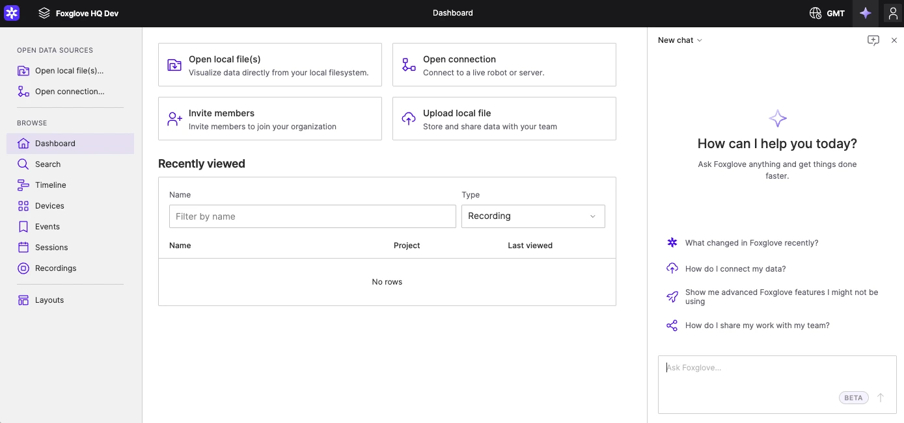
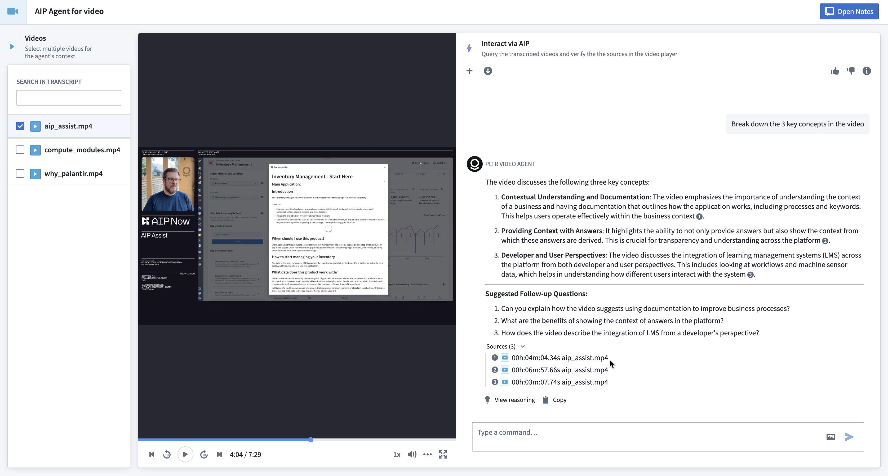
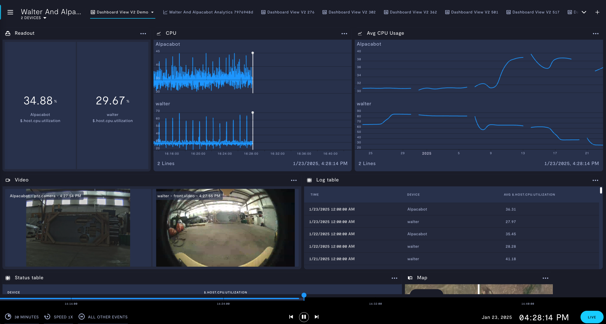
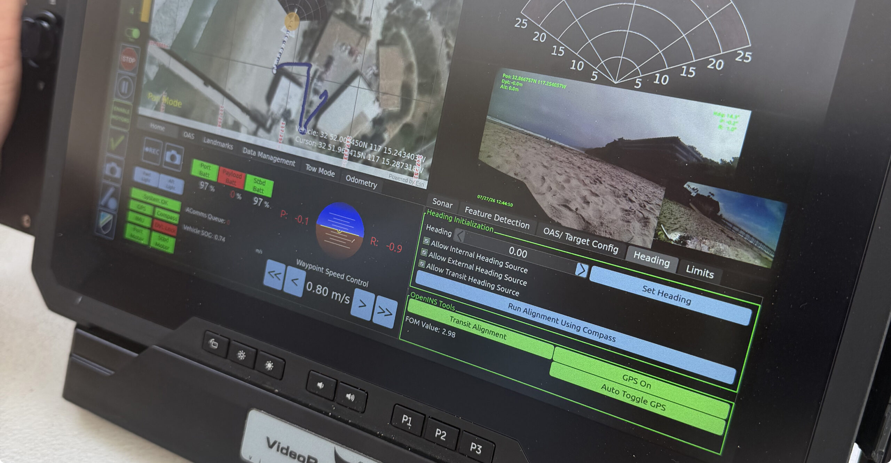
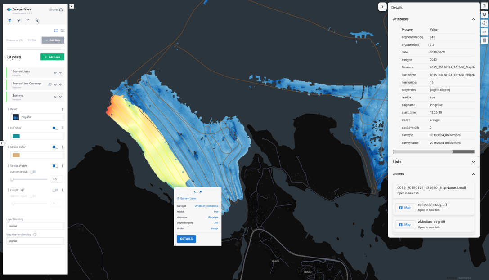
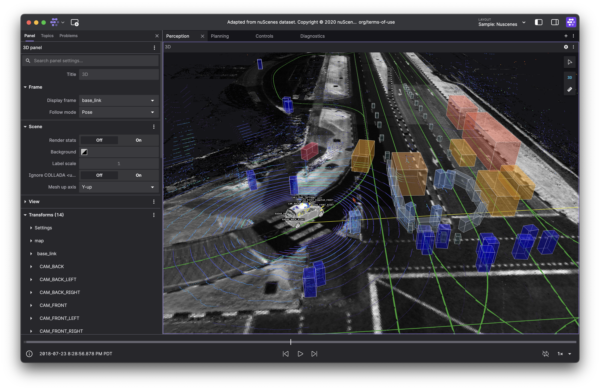
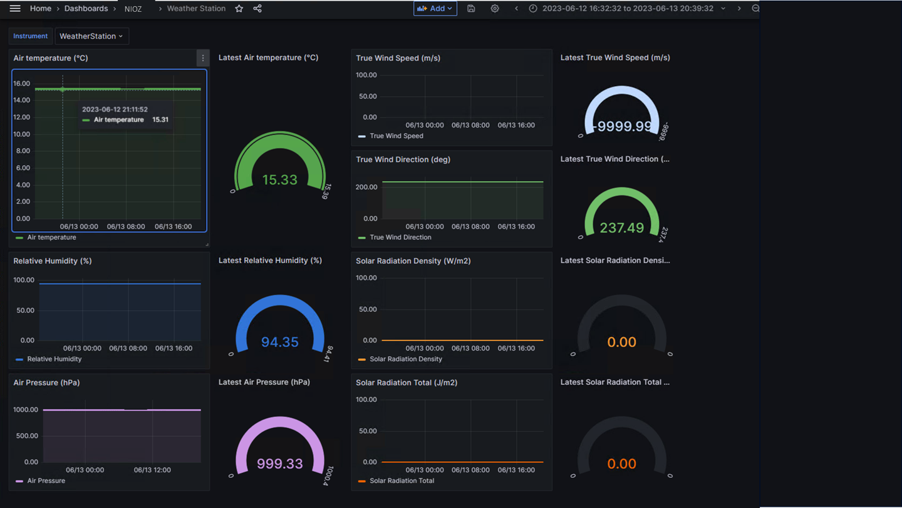

# 水下智能体产品 UI 参考图册

调研日期：2026-10-19。

本图册面向水下多智能体任务决策系统，筛选近期有官方更新、与业务定位有交集的 6 个产品。排序表示参考优先级，不是用户量或流量热度排名。

当前对话与任务工作单优先参考 Foxglove、Palantir；监控页参考 Formant；发布确认参考 Dify。Greensea 与 Kongsberg 用于校准水下作业的信息组织。产品标题与置顶模拟时间延续当前设计。

## 打开方式

在当前 IDE 按 Ctrl+P 输入 `docs/ui-references/README.md`，再按 Ctrl+Shift+V 预览。图片均位于同一项目目录；点击图片链接可查看原图。也可以在浏览器打开本目录的 [index.html](index.html) 查看双栏图册。

## 参考总览

| 产品 | 参考重点 | 官方来源 |
| --- | --- | --- |
| Foxglove · 机器人数据与 Agent | 重点：Agent 与工作区协作 | [官方界面与说明](https://docs.foxglove.dev/docs/agents/agent-sidebar) |
| Palantir AIP · Chatbot Studio / Workshop | 重点：业务对象与对话 | [官方界面与说明](https://www.palantir.com/docs/foundry/chatbot-studio/overview) |
| Formant · 机器人群运营 | 重点：深色监控与多机状态 | [官方界面与说明](https://docs.formant.io/docs/fleet-observability) |
| Dify · Human Input | 重点：人工核对与确认 | [官方界面与说明](https://www.dify.ai/blog/the-human-input-node-bringing-human-judgment-into-automated-workflows) |
| Greensea IQ · Bayonet Workspace | 行业：水下机器人作业 | [官方界面与说明](https://greenseaiq.com/bayonet-workspace/) |
| Kongsberg · Blue Insight / Geomatics | 行业：海洋数据与空间上下文 | [官方界面与说明](https://www.kongsberg.com/what-we-do/ocean-space/ocean-science/geomatics/) |

## Foxglove · 机器人数据与 Agent

**重点：Agent 与工作区协作**

官方 Agent sidebar 文档空态截图：左侧导航、中央数据接入、右侧 Agent。尚未加载机器人数据，截图拍摄日期未确认。

- 界面观察：主工作台与 Agent 侧栏并排。首屏提供数据接入入口和示例问题，输入框固定在侧栏底部；官方文档还展示工具调用展开与变更确认流程。
- 用于本项目：对话应与当前机器人、任务和异常关联，回答可以定位到对应对象或时间；把处理记录折叠为可展开步骤，待确认操作显示明确摘要。
- 近期证据：2026-08-18 发布 Agent 侧栏与 MCP；2026-10-06 发布 3D Maps。当前 Agent 侧栏文档仍标为 beta。 [查看来源](https://foxglove.dev/blog/foxglove-goes-agentic) · [补充来源](https://foxglove.dev/blog/introducing-3d-maps-in-foxglove)
- 图片出处：[官方页面](https://docs.foxglove.dev/docs/agents/agent-sidebar) · [官方原图](https://docs.foxglove.dev/assets/images/ask-foxglove-button-5ba28495aab087a1dfda0997bd9bec29.webp)

## Palantir AIP · Chatbot Studio / Workshop

**重点：业务对象与对话**

官方 Workshop 示例应用：资料列表、视频内容、带来源的问答。示例图仍出现 Agent 字样。

- 界面观察：左侧选择资料，中部查看内容，右侧进行问答；回答附来源编号与时间位置。
- 用于本项目：设备能力、任务参数与问答保持关联；给水深限制、设备能力等结论提供可展开来源，减少来回翻聊天。
- 近期证据：2026-04-22 公告宣布 AIP Agent Studio 更名为 AIP Chatbot Studio；本图来自当前文档。 [查看来源](https://www.palantir.com/docs/foundry/announcements/2026-04#aip-agent-studio-is-now-aip-chatbot-studio)
- 图片出处：[官方页面](https://www.palantir.com/docs/foundry/chatbot-studio/overview) · [官方原图](https://www.palantir.com/docs/resources/foundry/chatbot-studio/workshop-agent.png)

## Formant · 机器人群运营

**重点：深色监控与多机状态**

官方设备组示例：两台机器人的数值、曲线、视频及日志同屏；截图内日期为 2025-01-23。

- 界面观察：顶部明确设备组与当前视图，底部统一时间轴、回放控制和 LIVE 标识。蓝灰面板配青色强调，数值与图表层级明确。
- 用于本项目：用于运行监控页：标明当前机器人范围、遥测更新时间和实时／历史模式；异常项直接进入相应设备详情。
- 近期证据：官方维护的 Python 包 1.374.0 于 2026-09-29 发布，说明生态仍活跃；不据此认定示例截图就是最新界面。 [查看来源](https://pypi.org/project/formant/)
- 图片出处：[官方页面](https://docs.formant.io/docs/fleet-observability) · [官方原图](https://files.readme.io/78972bda3144d3247a66d9a0288c002a137e64212b7561bc88532257792e8fa1-Screenshot_2025-01-23_at_4.28.14_PM.png)

## Dify · Human Input

**重点：人工核对与确认**

2026 年官方发布文章的配置与 Test Run 表单预览合图，属于工作流构建和测试界面。

- 界面观察：核对内容、评论输入框和 Confirm／Regenerate／Forward 操作放在同一表单；每个动作指向不同的后续分支。
- 用于本项目：把现有发布确认组织成清晰的任务摘要、约束结果与修改意见；操作按钮直接表达确认发布或返回修改。
- 近期证据：2026-03-03 发布 Human Input 功能说明，对应 v1.13.0。 [查看来源](https://www.dify.ai/blog/the-human-input-node-bringing-human-judgment-into-automated-workflows)
- 图片出处：[官方页面](https://www.dify.ai/blog/the-human-input-node-bringing-human-judgment-into-automated-workflows) · [官方原图](https://assets.dify.ai/official/blog/2026/03/7d2f1c6f7a49c4a9.png)

## Greensea IQ · Bayonet Workspace

**行业：水下机器人作业**

官方产品页中的操作终端屏幕实拍，保留原图；不是平面截屏。

- 界面观察：地图、视频、声呐、姿态和控制信息共处作业界面。设备、传感器与任务工具有明确分区。
- 用于本项目：作为行业信息组织参考：任务执行时保持作业区域、机器人状态、传感器信息和控制模式可辨认。完整遥测界面适合后续执行页。
- 近期证据：2026-03-10 发布 Bayonet 操作训练模拟器，明确沿用 Workspace 作业软件。 [查看来源](https://greenseaiq.com/news/bayonet-simulator/)
- 图片出处：[官方页面](https://greenseaiq.com/bayonet-workspace/) · [官方原图](https://greenseaiq.com/wp-content/uploads/2026/08/Workspace-Hero-scaled.jpg)

## Kongsberg · Blue Insight / Geomatics

**行业：海洋数据与空间上下文**

官方 OceanView 示例：左侧图层、中央海洋空间数据、右侧对象属性。示例数据日期不代表当前版本日期。

- 界面观察：地图占据主要空间，图层控制和选中对象详情分置两侧；传感器仪表盘将即时数值与趋势配对。
- 用于本项目：后续把作业位置、管线和环境图层关联到任务，并允许从对象进入对应测量记录；环境指标同时标出单位与采集时间。
- 近期证据：2025-04-08 发布 Geomatics；2026 年 Oceanology International 工作坊继续展示 Blue Insight 的管线调查数据处理。 [查看来源](https://www.kongsberg.com/event/oi-2026/leif-bildoy/) · [补充来源](https://www.kongsberg.com/news/news-archive/2025/transforming-ocean-data-management/)
- 图片出处：[官方页面](https://www.kongsberg.com/what-we-do/ocean-space/ocean-science/geomatics/) · [官方原图](https://www.kongsberg.com/globalassets/kongsberg/1.-what-we-do/2.-ocean-space/3.-ocean-science/blue-insight/geomatics/geomatics_example.png)

## 补充界面

### Foxglove 数据工作区

当前文档提供的示例，截图版本日期未确认；与上面的 Agent 空态分开看。[官方 Panels 文档](https://docs.foxglove.dev/docs/visualization/panels) · [官方原图](https://docs.foxglove.dev/assets/images/settings-tab-bb0ebd651ff0565a80294188f8bc44bb.png)

### Kongsberg 仪器状态

官方示例中即时数值与趋势并列；画面使用历史样例数据，未据此推断当前 UI 版本。[官方产品页](https://www.kongsberg.com/what-we-do/ocean-space/ocean-science/geomatics/) · [官方原图](https://www.kongsberg.com/globalassets/kongsberg/1.-what-we-do/2.-ocean-space/3.-ocean-science/blue-insight/geomatics/picture1.png)

## 对当前界面的具体建议

1. 保留现在的产品标题和置顶模拟时间，让当前任务、目标设备和工作模式有固定位置。
2. 对话中的设备能力和约束判断提供可展开的来源、单位和数据时间；点击结果能定位到工作单对应项。
3. 发布前集中展示任务摘要、未解决问题和修改入口。与任务发布、机器人下发相关的操作继续服从现有权限与确认规则。
4. 运行监控按机器人和任务组织，区分实时与历史。地图、三维视图和回放需要相应数据支持，适合作为后续阶段。

图片保留官方原样，权利归相应厂商；本图册用于设计研究。所有“用于本项目”的内容均为设计建议，不表示这些能力已在本项目实现。

